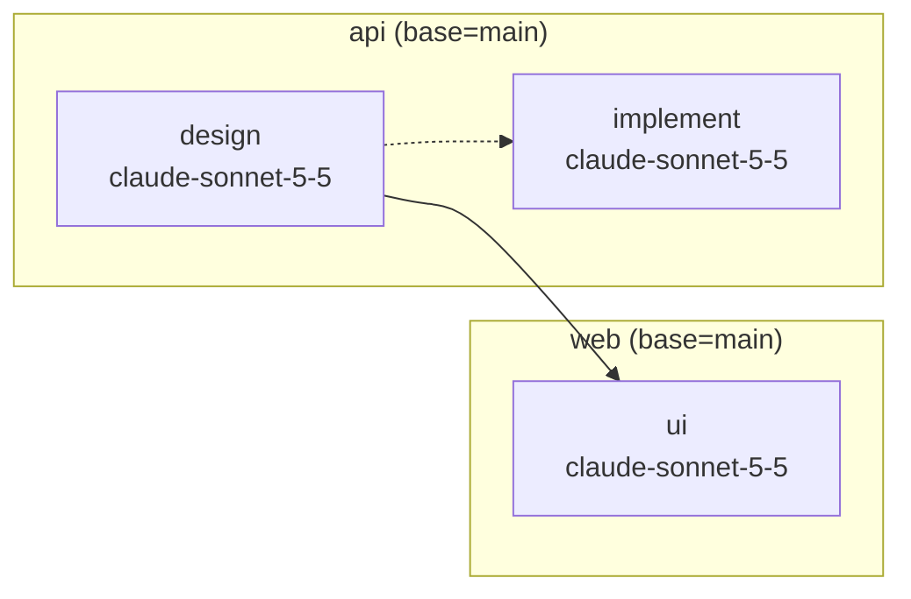

# herda API Specification

- Status: **Draft v0.1**
- Package: `herda`
- Runtime: Python 3.11+
- Built on: [`herdr-core`](https://herdr.dev/core/) (`hc`) protocol generation 1
- Observability: [`herdr app`](https://herdr.dev/)
- Verified with: `hc` 0.1.21, Pi 1.6.0
- Date: 2026-11-22

**目次**: [1. 目的](#1-目的) / [2. 用語](#2-用語) / [3. 設計原則](#3-設計原則) / [4. クイックスタート](#4-クイックスタート) / [5. 公開 API](#5-公開-api) / [6. DAG](#6-dag) / [7. 実行セマンティクス](#7-実行セマンティクス) / [8. herdr 連携](#8-herdr-連携) / [9. CLI](#9-cli) / [10. エラー](#10-エラー) / [11. セキュリティ](#11-セキュリティ) / [12. テスト](#12-テスト) / [13. v0.1 の範囲](#13-v01-の範囲)

---

## 1. 目的

**git worktree を CUDA の stream のように扱い、pi の 1 prompt 実行を kernel として DAG に組む Python ライブラリ。**

```
Python (herda)
  └─ DAG scheduler
       ├─ worktree A ── herdr terminal ── pi (prompt A1 → A2 → ...)
       ├─ worktree B ── herdr terminal ── pi (prompt B1)
       └─ worktree C ── herdr terminal ── pi (prompt C1)
                            ▲
                            │ 同じ herdr-core
                       herdr app で全実行中セッションを閲覧
```

### 1.1 やること

- Stream と git worktree を 1:1 で対応させる
- Stream ごとに Kernel（= 1 herdr セッション = 1 prompt 実行）を順番に実行する
- Kernel 間の依存から DAG を組み、依存が満たされた Kernel を並列実行する
- worktree の作成・破棄を行う
- herdr terminal 上で pi を起動し、モデルと prompt を渡す
- OSC 7501 の `idle` / `working` / `blocked` / `done` / `error` で完了を検知する
- 完了後にセッションを閉じ、次の Kernel を新しいセッションとして開始する
- 実行中のセッションを herdr app から見える状態に保つ
- DAG を Mermaid として描画する

### 1.2 やらないこと

- herdr app の置き換え、GUI
- エージェントのサンドボックス化
- 直接 LLM API を呼ぶこと
- 画面テキストからの状態推測
- 複数リポジトリをまたぐ DAG
- host からリモート machine の worktree を操作すること（herda は core と同じマシンで動かす。§8.3）
- stream 間の自動マージ／ファイル転送
- 特定の過去 pi session への復帰
- engine 死亡後の run 再開（§13）
- Kernel の retry（§13）
- result file による成功判定（§13）
- headless agent（§13）

### 1.3 ユースケース

1. 1 つのリポジトリに複数の worktree を作り、別々のモデル／prompt で並列にコーディングさせる
2. ある Kernel の完了後に別の Kernel を走らせる（同一 worktree 内の直列、または stream 間の依存）
3. 実行中は herdr app で「どの worktree のどの Kernel が動いているか」を見る
4. blocked になったら herdr app で承認し、そのまま再開させる
5. 完了後に worktree / branch を確認し、必要なら git で統合する
6. DAG を Mermaid で描いてレビューする

---

## 2. 用語

| 用語 | 定義 |
|---|---|
| **Graph** | DAG 全体。1 つの git リポジトリを持つ。 |
| **Stream** | 実行レーン。1 つの git worktree / branch に対応する。 |
| **Kernel** | DAG のノード。1 つの prompt を 1 つのセッションで実行する。 |
| **Session** | 1 Kernel の 1 prompt 実行。prompt 投入からターン完了まで。 |
| **Execution** | Graph を 1 回実行したインスタンス。`run_id` を持つ。 |
| **Worktree** | Stream が使う `git worktree`。herda が作成・破棄する。 |
| **Herdr terminal** | herdr-core 上の terminal。`t7` などの address を持つ。 |

### 2.1 責務境界

| レイヤ | 責務 |
|---|---|
| **herda** | DAG、worktree、pi 起動、モデル指定、prompt 投入、完了検知、セッションのリセット／引き継ぎ |
| **herdr-core (`hc`)** | terminal の保持、attach/read/send/wait、OSC 7501、labels、イベント |
| **pi** | コーディング、OSC 7501 の報告、会話履歴 |
| **herdr app** | 実行中 terminal の一覧・attach・承認 |

> herda は `hc` を Python からラップする。独自の PTY やデーモンは持たない。

### 2.2 CUDA との対応

| CUDA | herda |
|---|---|
| graph | Graph |
| stream | Stream = worktree |
| kernel | Kernel = 1 prompt 実行 |
| stream 内の順序 | 宣言順（暗黙に直列） |
| stream 間の並列 | `max_parallel` |
| stream 間の同期 | `record_event` / `wait_event` / `wait_stream` |
| stream synchronize | `Execution.wait_stream()` |
| device synchronize | `Execution.wait()` / `synchronize()` |

---

## 3. 設計原則

1. **名前はユーザーが付ける。** Graph / Stream / Kernel の `name` は必須。herdr terminal 名など内部 ID だけ自動生成する。
2. **Stream は worktree、Kernel はセッション。** 1 Stream 内は直列、異なる Stream は並列。
3. **Stream 間の同期は event。** Kernel に `depends_on` は付けない。Stream が event を record し、別の Stream が wait する。
4. **既定では会話を引き継がない。** 引き継ぎは `inherit_session=True` のときだけ。直前 Kernel の会話のみ。
5. **worktree は herda が所有する。** ただし未コミット変更を破壊しない。削除は明示操作のみ。
6. **完了は OSC 7501 だけを信じる。** 画面文字列で成功判定しない。
7. **herdr app がライブ一覧。** herda は `herdr.space` / `herdr.tab` と表示名を整える。
8. **v0.1 は小さく。** 再開、retry、result 判定などは入れない（§13）。

名前は 1–64 Unicode 文字。制御文字と `/` は禁止（`/` は `stream/kernel` の区切り）。同じ階層で一意。

---

## 4. クイックスタート

### 4.1 前提

- Linux / macOS
- `git` 2.30+
- `hc` がインストールされ、`hc server status` が動く
- `pi` 1.6+（OSC 7501 対応）
- `herdr app`（表示に使う場合は起動しておく）
- Python 3.11+

```bash
pip install herda
herda doctor
```

`herda doctor` は `git`、`hc`、`pi` のバージョン、OSC 7501 の観測（`--deep`）、`herdr-app` の有無（`--app`）を確認する。

### 4.2 最小の DAG

```python
from pathlib import Path
from herda import Graph, RunState

graph = Graph(
    name="auth-refactor",
    repo=Path("/home/me/src/app"),
    default_model="anthropic/claude-sonnet-5-5",
)

api = graph.stream("api", base="main")
design = api.kernel("design", "prompts/design.md")
design_done = api.record_event("design_done")
api.kernel("implement", "prompts/implement.md")
api.kernel("test", "prompts/test.md")

web = graph.stream("web", base="main")
web.wait_event(design_done)
web.kernel("ui", "prompts/ui.md")

execution = graph.run()          # 完了までブロック
assert execution.state == RunState.succeeded

graph.draw("dag.mmd")
```

- `api` と `web` は別 worktree / branch。
- `api` 内は `design` → `implement` → `test` の順に直列。
- `api/design` 完了時に `design_done` を record。
- `web` は `design_done` を wait してから `ui` を開始する。
- `design_done` は record した時点までの `api` の Kernel を表す。後から `api` に追加した Kernel は含まない。
- `implement` は既定で `design` の会話を引き継がない。

### 4.3 引き継ぎ

```python
api = graph.stream("api", base="main")
design = api.kernel("design", "prompts/design.md")
api.kernel(
    "implement",
    "prompts/implement.md",
    inherit_session=True,
)
```

`inherit_session=True` は、同じ Stream の直前 Kernel が成功した場合だけ `pi --no-approve --continue` で会話を引き継ぐ。

### 4.4 状態を見る

```bash
# herdr app を開く。Graph 名の space、Stream 名の tab に Kernel が出る。
# CLI から:
hc ls --label herda.owner=herda
hc attach <terminal>

# DAG
herda draw graph.py -o dag.mmd
```

---

## 5. 公開 API

### 5.1 import

```python
from herda import (
    Graph, Stream, Kernel, Event, Execution,
    RunState, KernelState,
    KernelResult, ErrorInfo,
    HerdaError, ValidationError, PromptError, WorktreeError,
    HerdrError, HerdaTimeoutError, ConcurrentRunError, CleanupError,
)
```

### 5.2 列挙型

```python
class RunState(str, Enum):
    pending = "pending"
    running = "running"
    succeeded = "succeeded"
    failed = "failed"
    canceled = "canceled"

class KernelState(str, Enum):
    pending = "pending"
    ready = "ready"
    running = "running"
    awaiting_input = "awaiting_input"  # エージェントが blocked
    succeeded = "succeeded"
    failed = "failed"
    skipped = "skipped"                # 依存失敗など
    canceled = "canceled"
```

### 5.3 `Graph`

```python
class Graph:
    def __init__(
        self,
        name: str,
        repo: str | Path,
        *,
        default_model: str,
        base_dir: str | Path | None = None,
        max_parallel: int = 4,
        ready_timeout_s: float = 120.0,
        session_timeout_s: float | None = None,
        blocked_timeout_s: float | None = 3600.0,
        status_timeout_s: float | None = 300.0,
        agent_args: Sequence[str] = (),
        env: Mapping[str, str] | None = None,
    ) -> None: ...

    def stream(self, name: str, *, base: str = "HEAD") -> Stream: ...

    def validate(self) -> None: ...
    def start(self) -> Execution: ...
    def run(self) -> Execution: ...

    def to_mermaid(self, *, direction: Literal["LR", "TB"] = "LR") -> str: ...
    def draw(self, path: str | Path, *, direction: Literal["LR", "TB"] = "LR") -> Path: ...

    def cleanup(
        self,
        run_id: str,
        *,
        worktrees: bool = False,
        branches: bool = False,
        force: bool = False,
    ) -> None: ...

    @property
    def streams(self) -> Mapping[str, Stream]: ...
    @property
    def kernels(self) -> Mapping[str, Kernel]: ...
    @property
    def events(self) -> Mapping[str, Event]: ...
```

| 引数 | 既定 | 意味 |
|---|---|---|
| `name` | 必須 | Graph 名。space 名、run ディレクトリ、branch に使う。 |
| `repo` | 必須 | 対象 git リポジトリ。 |
| `default_model` | 必須 | Kernel の既定モデル（`provider/model`）。 |
| `base_dir` | `cwd` | prompt の相対パス解決の起点。 |
| `max_parallel` | `4` | 同時に実行する Session 数。 |
| `ready_timeout_s` | `120.0` | terminal 起動から agent ready までの上限。 |
| `session_timeout_s` | `None` | prompt 投入から完了までの上限。`None` は無制限。Kernel の `timeout_s` が優先。 |
| `blocked_timeout_s` | `3600.0` | 連続 blocked の上限。`None` は無制限。 |
| `status_timeout_s` | `300.0` | 最初の report 後に status が途切れてよい上限。`None` は無制限。 |
| `agent_args` | `()` | すべての Kernel に渡す追加の agent CLI 引数。 |
| `env` | `{}` | すべての Kernel に渡す追加環境変数。Kernel の `env` が優先。 |

**セマンティクス**

- `stream()` / `kernel()` は `start()` 前に呼ぶ。`start()` 後の変更は `ValidationError`。
- `start()` が成功した Graph は 1 回だけ実行できる。validate / preflight / lock / worktree 作成の失敗では `_start_attempted` を戻すため、修正後に同じ Graph で再試行できる。
- `validate()` は副作用なし。名前、重複、空 Graph / Stream、循環、prompt、モデル、git を検査する。
- `start()` は validate、worktree 作成、prompt スナップショットを行ってから実行を開始し、`Execution` を返す。
- `run()` は `start()` + `wait()`。
- Kernel の失敗は例外ではなく `KernelResult` に記録し、`RunState.failed` を返す。preflight 失敗だけが例外。
- `draw()` は raw Mermaid を UTF-8 で書き、パスを返す。拡張子は `.mmd` / `.md`。
- `cleanup()` は run の後始末。terminal を labels で探して kill / rm し、`worktrees=True` のときだけ worktree を削除する。dirty なら `force=True` が無い限り `CleanupError`。`branches=True` のときだけ `herda/<graph_slug>/...` の branch を削除する。active な run（lock 保持中）には使えない。

### 5.4 `Stream`

```python
class Stream:
    name: str
    graph: Graph
    base: str
    branch: str | None       # start 後に確定
    worktree: Path | None    # start 後に確定

    def kernel(
        self,
        name: str,
        prompt: str | Path,
        *,
        model: str | None = None,
        inherit_session: bool = False,
        timeout_s: float | None = None,
        agent_args: Sequence[str] | None = None,
        env: Mapping[str, str] | None = None,
    ) -> Kernel: ...

    def record_event(self, name: str | None = None) -> Event: ...
    def wait_event(self, event: Event) -> None: ...
    def wait_stream(self, stream: Stream) -> None: ...

    @property
    def kernels(self) -> tuple[Kernel, ...]: ...
    @property
    def recorded_events(self) -> tuple[Event, ...]: ...
```

- `base` は branch / tag / commit。`start()` 時に commit に固定する。
- branch / worktree は自動決定（§7.1）。v0.1 では明示指定しない。
- 空の Stream は `ValidationError`。
- Stream 内の Kernel は宣言順に直列。Kernel に依存指定は無い。
- `record_event(name=None)` はその時点の Stream の末尾を event として記録し、`Event` を返す。`name` を省略すると `event-<n>` が自動で付く。まだ Kernel が無い Stream でも record できる（待っても何も待たない）。
- `wait_event(event)` は、この呼び出しより後に宣言する次の Kernel だけを event 完了まで待たせる。呼び出し前に宣言済みの Kernel には影響しない。
- `wait_stream(stream)` は、呼び出し時点の `stream` の末尾 Kernel を待つ。`other.record_event()` + `self.wait_event()` の簡略形で、PyTorch/CUDA の `wait_stream` に相当する。呼び出し後に `stream` へ追加した Kernel は待たない。
- 同じ Stream が自分の event / stream を wait しても no-op（Stream 内は既に直列）。
- event 名は Graph 内で一意。`start()` 後の record / wait は `ValidationError`。

### 5.5 `Kernel`

```python
@dataclass(frozen=True)
class Kernel:
    graph: Graph
    stream: Stream
    name: str
    prompt: Path
    model: str
    inherit_session: bool
    timeout_s: float | None
    agent_args: tuple[str, ...]
    env: Mapping[str, str]

    @property
    def qualified_name(self) -> str: ...   # "api/implement"
```

- `timeout_s` は `Graph.session_timeout_s` をこの Kernel だけ上書きする。`None` なら Graph の値。
- `agent_args` / `env` を省略すると `Graph.agent_args` / `Graph.env` を継承する。Kernel 側の `env` は Graph 側より優先。
- Kernel 名は同じ Stream 内で一意。`"stream/kernel"` は Graph 内で一意。
- Kernel に `depends_on` / 依存フィールドは無い。順序は Stream 内の宣言順と event wait から決まる。
- `inherit_session=True` は同じ Stream の直前 Kernel がある場合だけ有効。
- 依存関係は `validate()` で検査し、循環も検出する。

### 5.6 `Event`

```python
@dataclass(frozen=True)
class Event:
    graph: Graph
    stream: Stream
    name: str
    after: Kernel | None       # record 時点の Stream 末尾。空なら None

    @property
    def qualified_name(self) -> str: ...   # "api/design_done"
```

- `record_event()` が返す graph-wide なハンドル。名前は Graph 内で一意。
- `after` は record した時点でその Stream に宣言されていた最後の Kernel。event はその Kernel の成功で完了する。
- record 後に同じ Stream へ追加した Kernel は event に含まれない。
- 複数の Stream が同じ event を wait できる。
- event は 1 回だけ record する。再 record は `ValidationError`。

### 5.7 `Execution`

```python
class Execution:
    id: str
    state: RunState
    started_at: datetime
    finished_at: datetime | None
    run_dir: Path

    def wait(self, timeout_s: float | None = None) -> Execution: ...
    def synchronize(self) -> Execution: ...
    def query(self) -> bool: ...
    def wait_stream(self, stream: Stream | str, timeout_s: float | None = None) -> Execution: ...
    def query_stream(self, stream: Stream | str) -> bool: ...
    def cancel(self, *, grace_s: float = 10.0) -> None: ...

    @property
    def kernels(self) -> Mapping[str, KernelResult]: ...
```

- `wait()` / `synchronize()` は終端までブロック。CUDA の device synchronize に相当。`timeout_s` は待ち時間の上限で、run は止めない。超過時は `HerdaTimeoutError`。
- `query()` は run 全体が終端かどうかを返す。
- `wait_stream(stream)` は指定 Stream の全 Kernel が終端になるまで待つ。CUDA の stream synchronize に相当し、run 全体は止めない。
- `query_stream(stream)` は指定 Stream の全 Kernel が終端かどうかを返す。
- `cancel()` は新規スケジュールを止め、実行中 Session を `interrupt` → grace 後に `kill` → `hc rm` し、`RunState.canceled` にする。実行中は `KernelState.canceled`、未実行は `skipped`（`error.code="canceled"`）。worktree は残し、lock は解放する。
- `kernels` のキーは `"stream/kernel"`。

**注意**: `start()` はプロセス内のバックグラウンド実行。Python プロセスが終了すると DAG も止まる。herdr terminal は生き残るが、v0.1 に resume は無い（§13）。

### 5.8 結果型

日時は UTC aware。永続化時は ISO 8601（`Z`）。

```python
@dataclass(frozen=True)
class ErrorInfo:
    code: str
    message: str
    hint: str | None

@dataclass(frozen=True)
class KernelResult:
    name: str                      # "api/implement"
    stream: str
    state: KernelState
    model: str
    terminal: str | None           # herdr address
    branch: str
    worktree: Path
    prompt_sha256: str
    status: str | None             # 最後の OSC 7501 state
    started_at: datetime | None
    finished_at: datetime | None
    duration_s: float | None
    output_path: Path | None       # 保存した screen
    error: ErrorInfo | None
```

- `status` は `idle` / `done` / `error` など、最後に観測した値。
- `output_path` は `screen.txt`。
- 成功判定は `KernelState`。`status` だけでは判断しない。

---

## 6. DAG

### 6.1 ノードと辺

- ノード = Kernel。
- 辺 = 依存。`A -> B` は A 成功後に B 開始。
- 同一 Stream 内は宣言順に暗黙辺 `k1 -> k2 -> k3`。Kernel に依存指定は無い。
- Stream 間の辺は event で作る。Stream A が `record_event` した時点の末尾 Kernel から、Stream B の `wait_event` 後の最初の Kernel へ辺が張られる。
- `wait_event` は次の 1 Kernel だけに効く。その後は Stream B 内の直列辺で順序が伝播する。
- DAG でなければならない。

```
stream api:   design ──> implement ──> test
                 │
                 │ record design_done
                 ▼
stream web:      ui
                 （wait_event(design_done) してから ui）
```

### 6.2 実行規則

1. 依存がすべて `succeeded` になった Kernel が `ready`。
2. 同じ Stream で実行中の Kernel が無い `ready` だけが `running` になれる。
3. 全体の同時実行数は `max_parallel` 以下。
4. 依存が `failed` / `skipped` / `canceled` なら下流は `skipped`。
5. 1 Kernel の失敗は、無関係な Stream を止めない。
6. 最終状態:
   - 全 Kernel 成功 → `succeeded`
   - 1 つでも失敗／失敗由来の skip → `failed`
   - `cancel()` → `canceled`

### 6.3 描画



- Stream は `subgraph`。
- ノードは Kernel 名 + モデル。
- Stream 内の暗黙辺は点線、event wait による Stream 間の辺は実線。
- `to_mermaid()` は静的な DAG。ライブ状態は herdr app で見る。

---

## 7. 実行セマンティクス

### 7.1 1 Stream = 1 worktree = 1 branch

- 自動 branch: `herda/<graph_slug>/<stream_slug>-<run6>`。
  - `run6` は `run_id` の末尾 6 文字（ランダム部）。
  - run ごとに新しい branch なので、再実行が前回の変更を引き継がない。
- 自動 worktree: `<repo>/.herda/worktrees/<graph_slug>/<run_id>/<stream_slug>`。
- `base` は `start()` 時に commit hash に固定し、`run.json` に保存する。
- 既存 path / branch の衝突は `WorktreeError`。既存 worktree を adopt しない。
- preflight 途中で失敗したら、その preflight で作った clean な worktree と、それに伴い新規作成した branch を rollback する。既存の worktree / branch は触らない。
- worktree 内の `.herda/` は `.herda/.gitignore` の `*` で無視する。メイン repo 側は `.git/info/exclude` に `.herda/` を追加する。
- branch は削除しない。統合・削除はユーザーが git で行う。

### 7.2 Session のライフサイクル

```
starting ── idle ──> ready ── send ──> sending ── working ──> succeeded
                                             │
                                             ├─ blocked ──> awaiting_input
                                             │                 │ 人間が解決
                                             │                 └──> working
                                             ├─ error ─────> failed
                                             └─ lost ──────> failed
```

- **Session = 1 prompt 実行**。prompt 投入からターン完了まで。
- 1 Stream で active な Session は **最大 1**。起動前に必ず検査する。
- 1 Session = 1 herdr terminal。
- 完了／失敗確定後:
  1. screen を `screen.txt` に保存
  2. `hc kill` で pi を終了
  3. `hc rm` で terminal を除去
- これが「セッションのリセット」。同じ worktree に idle の pi を残さない。
- 次 Kernel は新しい terminal / 新しいプロセスで始まる。
- `blocked` 待機中だけはプロセスを生かす。人間が herdr app で承認／回答する。
- 最終化では、画面保存・meta 保存・label 更新・kill / rm のどこかが失敗しても、残りの回収処理を続ける。保存失敗は Kernel の成否を変えない。

### 7.3 Prompt

- `prompt` は必須の `.md` ファイル（大文字小文字無視）。存在しない／空／読めないは `PromptError`。
- 相対パスは `Graph.base_dir` 基準。
- `start()` 時に読み、run ディレクトリへスナップショットし、SHA-256 を記録する。
- 投入方法は自動のみ:
  - UTF-8 で 48 KiB 以下: `hc send` で本文を貼り付けて Enter。
  - 48 KiB 超: `<worktree>/.herda/prompts/<stream>/<kernel>.md` に置き、そのファイルを読んで実行するよう `hc send` で指示する。
- prompt のテンプレート展開はしない。動的な値は環境変数（§8.5）を使う。Stream 間で git 操作する prompt は `HERDA_BRANCHES` を読むよう明記する。
- `inherit_session=True` の prompt は、直前 Kernel の会話の続きとして書く。

### 7.4 モデル

- Kernel の `model` があればそれを使う。無ければ `Graph.default_model`。
- 形式は pi の `provider/model`（例: `anthropic/claude-sonnet-5-5`）。
- 空なら `ValidationError`。`pi --list-models` との照合は `herda doctor` で任意に行う。

### 7.5 セッション引き継ぎ

既定は **引き継がない**。

- 起動時は常に `pi --no-approve` を渡す。worktree の project-local Pi settings / extensions は読み込まず、trust dialog で kernel が止まらないようにする。`AGENTS.md` などの context file は Pi が読み込む。
- `inherit_session=False`: 新しい pi プロセス。worktree のファイルは前 Kernel のまま。会話は含まない。
- `inherit_session=True`:
  - 同じ run・同じ Stream の **直前 Kernel** が `succeeded` のときだけ有効。
  - 実装は `pi --continue` のみ。session id は記録しない。
  - 直前 Kernel が無い（最初の Kernel）場合は `ValidationError`。失敗した Kernel の下流は skip されるため、引き継ぎは実行されない。
  - 任意の過去 session に戻る機能は無い。
- `--continue` は worktree 内の最後の pi セッションを選ぶ。同じ worktree で手動 pi を動かすと誤った会話を拾うため、`inherit_session=True` の worktree では手動起動しないこと。

### 7.6 完了検知

herdr-core の OSC 7501 だけを使う。

1. terminal 起動後、最初の status report を待つ。
   - `idle` / `done` → ready。
   - `blocked` → 人間待ち。`blocked_timeout_s` が経過したら `blocked_timeout`。
   - `error` → 失敗。
   - `ready_timeout_s` まで report が無い → 失敗（`status_unavailable`）。
   - report はあるが idle / blocked / error のどれでもないまま `ready_timeout_s` を超えた → 失敗（`agent_not_ready`）。
   - 最初の report 後、`status_timeout_s` 以上 report が途切れた → `status_timeout`。
2. prompt 投入直前の `turn` を `T0` とする。
3. `hc send --wait` で prompt を投入する。
   - `started=false`: 15 秒まで `turn` / `working` を再観測。進まなければ失敗（`agent_not_started`）。
   - `started=null`: OSC 7501 非対応 → 失敗（`status_unavailable`）。
4. `hc send --wait` が `ended=false` で戻ったら、`session_timeout_s` まで `hc wait` を繰り返す。
5. `turn > T0` かつ状態が `working` でなくなったら完了。
   - `idle` / `done` → 成功。
   - `blocked` → `awaiting_input`。blocked のままなら 0.5–1 秒間隔で `hc get` をポーリングし、状態が変わるまで待つ。解決後に `working` → `idle` を待つ。
   - `error` → 失敗。
   - `idle` / `done` でも `turn` が進んでいない → 失敗（`agent_not_started`）。
   - terminal が `finished` → 失敗。
6. screen を保存し、`hc kill` → `hc rm`。

- `hc send --force` は使わない。承認を自動化しない。
- prompt 投入後の `blocked` は `blocked_timeout_s` で打ち切る。`None` の場合はユーザーが cancel するまで待つ。起動時の `blocked`（trust dialog など）も同じ `blocked_timeout_s` の対象。
- 最初の report 後に status report が `status_timeout_s` 以上途切れたら `status_timeout`。`working` のまま report が継続している長時間 tool 実行は対象外。
- `restarted` / `lost` は失敗（`session_lost`）。herdr app の adoption で `keep` が有効になり代替シェルが起動した場合は、そのシェルを kill する。

> 確認済み: Pi 1.6.0 を herdr-core 0.1.21 の terminal で起動すると、`hc get` に `{"app":"pi","state":"idle"}` が現れる。Pi 1.6+ は TUI から OSC 7501 を報告する。

### 7.7 ファイル配置と lock

```
<repo>/.herda/
  worktrees/
    <graph_slug>/<run_id>/<stream_slug>/   # git worktree
  runs/
    <run_id>/
      run.json
      prompts/<stream>/<kernel>.md         # prompt のスナップショット
      agent-sessions/<stream>/             # Pi の session dir（run ごとに隔離）
      sessions/<stream>/<kernel>/
        screen.txt
        meta.json
  locks/
    <graph_slug>.lock
```

- `run_id` は `YYYYMMDDTHHMMSSZ-<random6>`（UTC、sortable）。
- `run.json` は run の作成時に書き、状態遷移と終了時に state / finished_at を更新する。worktree / branch / Kernel の結果と agent 名を含み、`Graph.cleanup(run_id)` が読む。
- `meta.json` は Kernel ごとの terminal address、status、時刻、エラーを保存する。
- `screen.txt` は Session 終了時に `hc read` から保存する。保存失敗は Kernel を失敗させない。
- `agent-sessions/<stream>/` は Pi の `--session-dir`。`inherit_session=True` は同じ Stream のこの dir で `--continue` する。
- `locks/<graph_slug>.lock` は `flock`。同じ Graph の同時 run は `ConcurrentRunError`。app の space/tab と run 状態を一意に保つため。
- `run.json` は atomic write（temp + rename）する。
- **v0.1 は `run.json` から resume しない。** 記録は status 確認と cleanup のためだけに使う。

---

## 8. herdr 連携

### 8.1 terminal 起動

```bash
hc run --bg --json --no-parent --no-notify \
  --name herda-api-design-7f3a2c \
  --cwd /repo/.herda/worktrees/auth-refactor/20261122T051500Z-a1b2c3/api \
  --label herdr.space=herda-auth-refactor-1a2b \
  --label herdr.tab=herda-auth-refactor-1a2b-api-9c3d \
  --label herda.owner=herda \
  --label herda.graph=auth-refactor \
  --label herda.space_name=auth-refactor \
  --label herda.run=20261122T051500Z-a1b2c3 \
  --label herda.stream=api \
  --label herda.tab_name=api \
  --label herda.kernel=design \
  --label herda.session=20261122T051500Z-a1b2c3/api/design \
  --label herda.worktree=/repo/.herda/worktrees/auth-refactor/20261122T051500Z-a1b2c3/api \
  --label herda.branch=herda/auth-refactor/api-a1b2c3 \
  --label herda.model=anthropic/claude-sonnet-5-5 \
  --label herda.state=starting \
  -- env \
    HERDA_RUN_ID=20261122T051500Z-a1b2c3 \
    HERDA_GRAPH=auth-refactor \
    HERDA_STREAM=api \
    HERDA_KERNEL=design \
    HERDA_SESSION=20261122T051500Z-a1b2c3/api/design \
    HERDA_WORKTREE=/repo/.herda/worktrees/auth-refactor/20261122T051500Z-a1b2c3/api \
    HERDA_BRANCH=herda/auth-refactor/api-a1b2c3 \
    HERDA_BRANCHES='{"api":"herda/auth-refactor/api-a1b2c3","web":"herda/auth-refactor/web-a1b2c3"}' \
    pi --no-approve --model anthropic/claude-sonnet-5-5
```

- `hc run` に `--env` は無いため、POSIX の `env` を argv 先頭に置く。
- `--no-parent` / `--no-notify` で herdr の自動 note を抑止する。
- `--keep` は付けない。app の adoption で keep が有効になる場合があるため、`restarted` を失敗として扱う。
- 引き継ぎ時は `pi --no-approve --model <model> --continue`。

その他のコマンド:

| 目的 | コマンド |
|---|---|
| terminal 取得 | `hc get <terminal> --json` |
| 状態待ち | `hc wait <terminal> --timeout <s> --json` |
| prompt 投入 | `hc send --wait --json --timeout <s> <terminal> <text>` |
| 画面 | `hc read <terminal> --lines <n> --json` |
| label 更新 | `hc label <terminal> k=v …` |
| 中断 | `hc interrupt <terminal> --timeout <s>` |
| 終了 | `hc kill <terminal>` |
| 削除 | `hc rm <terminal>` |

### 8.2 herdr app 表示

herdr app は **任意の labels を画面表示しない**。app が一覧に出すのは `herdr.space` / `herdr.tab` labels を持つ terminal だけ。したがって次の対応にする。

| herdr app | herda | 表示名 |
|---|---|---|
| space | Graph | Graph 名 |
| tab | Stream / worktree | Stream 名 |
| terminal | Kernel / session | `herda-<stream>-<kernel>-<hash>` |
| agent status | OSC 7501 | `working` / `blocked` / 完了 |

```
auth-refactor                 # space = Graph
  api                         # tab = Stream / worktree
    herda-api-design-7f3a2c   # pane = Kernel（同時に 1 つ）
  web
    herda-web-ui-...
```

- `space_id = herda-<graph_slug>-<hash4(repo 正規化パス + Graph 名)>`。
- `tab_id = <space_id>-<stream_slug>-<hash4(Stream 名)>`。
- 4 hex の hash で、slug が衝突する名前でも app 上で混ざらない。
- すべての terminal に `herdr.space` / `herdr.tab` を付ける。
- app が未知の id を新しい space / tab として作った後、表示名をユーザー指定に合わせる:

```bash
herdr-app do space.rename '{"id":"<space_id>","name":"<graph name>"}'
herdr-app do tab.rename   '{"id":"<tab_id>","name":"<stream name>"}'
```

- `herdr-app` が無い／起動していない／rename が失敗した場合は、既定名のまま続行する。表示自体は labels で成立する。
- program 終了で app は pane を閉じる。tab は残る（空 tab を app が閉じる場合は次の Session で再作成）。
- `herda.*` labels は `hc ls` / `hc events` のフィルタ用。app の画面には出ない。
- 生の `herda.*` labels を app に並べたい場合は app mod が必要。v0.1 のスコープ外。

#### 8.2.1 名前の適用

| 表示 | 設定元 | 設定方法 |
|---|---|---|
| space 名 | `Graph.name` | `herdr.space` の ID で app に space を作らせ、`space.rename` で Graph 名にする |
| tab 名 | `Stream.name` | `herdr.tab` の ID で app に tab を作らせ、`tab.rename` で Stream 名にする |
| terminal 名 | `Kernel.name` / `Stream.name` | `hc run --name` で `herda-<stream>-<kernel>-<hash>` を付ける |

v0.1 では space/tab の独立した表示名フィールドは持たない。Graph 名 / Stream 名をそのまま使う。独立名が必要になったら `Graph(space_name=...)` / `Stream(tab_name=...)` を追加する。Graph / Stream 名を変えると ID も変わるため、別 space / tab になる。

- `herdr.space` / `herdr.tab` は **ID** であり、表示名ではない。表示名は必ず rename で入れる。
- 同じ terminal に希望名を label として持たせる:
  - `herda.space_name=<Graph.name>`
  - `herda.tab_name=<Stream.name>`
- **ローカル core**: herda が terminal 起動後に `herdr-app do space.rename` / `tab.rename` を直接呼ぶ。app がまだ space/tab を作っていなければ数秒リトライする。
- **SSH 先の core（devcontainer）**: herda はホストの app を直接呼べない。ホスト側で動く小さな helper `herda app-sync` が `hc events` / `hc ls` を監視し、`herda.space_name` / `herda.tab_name` を見て remote の space / tab を rename する予定（§8.3）。
- helper が無い場合でも、ID は run をまたいで安定しているので、app 上で一度手動 rename すれば以後も同じ名前が使われる。

### 8.3 SSH / devcontainer 構成

herdr-core を SSH 先の devcontainer で動かし、herdr app をホストで使う構成は **可能**。herdr app は local core に machine を追加し、その machine の space / tab / terminal を同じ画面に表示する。

推奨構成:

```
ホスト
  herdr app
  local herdr-core ── ssh ──> devcontainer
                                 herdr-core (hc)
                                 herda (Python)
                                 git worktrees
                                 pi
```

- **herda は core と同じ devcontainer 内で動かす。** herda から見れば local core なので、v0.1 の「worktree は local」制約を満たす。
- **ホスト側の local core** に devcontainer を machine として追加する（container 内の `hc` ではない）。`hc machine add <ssh-host>` または app の Add machine。CLI で行う場合も、app が使う local core に対して実行する。
- app の Add machine は SSH config の Host を列挙する。鍵認証で `ssh <host>` が非対話に通る状態にする。
- devcontainer 内の `hc` は app が install できる。architecture が違う場合は released build を使う。
- SSH は鍵認証で、パスワード／host-key プロンプトを出さないこと。stdout に余計なログを出さないこと。
- SSH サーバが無い／VS Code のトンネルしか無い場合は `--via` を使う。例:

```bash
# ホスト側の local core に追加
hc machine add --name devbox --install \
  --via 'ssh <host> docker exec -i <container> sh -c'
# または local docker の場合
hc machine add --name devbox --install \
  --via 'docker exec -i <container> sh -c'
```

`--via` は stdin/stdout をそのまま通し、PTY を要求しないコマンドにする。app の Add machine ダイアログは SSH config の Host を列挙するため、`--via` は CLI で追加してから app を開く。

制約:

- **コンテナが止まると session も止まる。** devcontainer の lifecycle（VS Code を閉じたときの停止など）に依存する。herdr-core の linger は container 内では期待できない。
- **herda は host から devcontainer の worktree を操作しない。** host で herda を動かす構成は v0.1 の対象外。
- **app の自動 rename は remote では herda 単体では効かない。** herda は container 内から host の `herdr-app` CLI を呼べないため、space/tab は Herdr の既定名になる。`herdr.space` / `herdr.tab` の ID は run をまたいで安定なので、**tab が残っている限り** app 上で一度 rename すれば以後も保持される。
- 完全自動にする場合は、**ホスト側で `herda app-sync`** を動かす予定。これは local core の `hc events` / `hc ls` を読み、`herda.space_name` / `herda.tab_name` labels を持つ remote terminal を見つけ、machine-qualified な space/tab ID に対して `herdr-app do space.rename` / `tab.rename` を実行する。app が起動していて `herdr-app` CLI が使えることが条件。
- この helper は Python API ではなく、ホスト側の運用コマンド（`herda app-sync`）として提供する。container 内では動かさない。host にも `herda` を install するか、app-sync 相当を独立した小さな helper として配布する。
- app の layout は machine 側 core の `herdr-app` document に保存される。remote core が書き込み可能であること。
- remote の `herdr.space` / `herdr.tab` は **その machine の local id**。herda は machine prefix を付けない（付けるのは app の表示だけ）。

### 8.4 labels

| label | 値 |
|---|---|
| `herdr.space` | app space id |
| `herdr.tab` | app tab id |
| `herda.owner` | `herda` |
| `herda.version` | `0.1` |
| `herda.graph` | Graph 名 |
| `herda.space_name` | app space の希望表示名（Graph 名） |
| `herda.run` | `run_id` |
| `herda.stream` | Stream 名 |
| `herda.tab_name` | app tab の希望表示名（Stream 名） |
| `herda.kernel` | Kernel 名 |
| `herda.session` | session id |
| `herda.worktree` | worktree の絶対パス |
| `herda.branch` | branch 名 |
| `herda.model` | モデル |
| `herda.state` | `starting` / `ready` / `sending` / `working` / `awaiting_input` / `succeeded` / `failed` / `lost` |

- 状態遷移のたびに `hc label` で `herda.state` を更新する。
- herdr terminal 名: `herda-<stream_slug>-<kernel_slug>-<hash6>`（最大 32 文字、`[a-z0-9_-]`）。`hash6` は `run_id + stream + kernel` の短縮ハッシュ。2 つの slug の合計が 18 文字を超える場合は後ろを切り詰める。

### 8.5 環境変数

| 変数 | 値 |
|---|---|
| `HERDA_RUN_ID` | run id |
| `HERDA_GRAPH` | Graph 名 |
| `HERDA_STREAM` | Stream 名 |
| `HERDA_KERNEL` | Kernel 名 |
| `HERDA_SESSION` | session id |
| `HERDA_WORKTREE` | worktree パス |
| `HERDA_BRANCH` | この Stream の branch |
| `HERDA_BRANCHES` | 全 Stream の branch（JSON object） |
| `HERDA_AGENT` | 実行 agent 名（現在は `pi`） |
| `HERDA_MODEL` | この Kernel のモデル |

- `HERDA_BRANCHES` は Stream 間の git 操作（`git log`、`merge`、`cherry-pick`）で上流 branch を知るために使う。
- Pi には `PI_PROGRAM_STATUS=1` を渡し、OSC 7501 の報告を明示する。
- Kernel の `env` は Graph の `env` を上書きする。`HERDA_*` は herda が最後に設定する。
- その他の環境変数はユーザーのシェルから継承する。herda は secret を保存しない。

---

## 9. CLI

Python ライブラリが主。CLI は最小限。

```bash
herda doctor [--deep] [--app] [--json]
herda validate graph.py
herda run graph.py [--timeout SECONDS]  # 完了までブロック
herda status [RUN_ID] [--json]          # run.json を表示
herda draw graph.py -o dag.mmd
herda clean RUN_ID [--worktrees] [--branches] [--force]

# ホスト側のみ。remote の space/tab 名を herda.* labels に合わせる（予定）
herda app-sync
```

- `graph.py` はモジュールレベルに `graph` という `Graph` を持つ。
- CLI は `graph.py` のあるディレクトリへ `chdir` してから import する。`base_dir` 未指定時の prompt 相対パスはそこを起点にする。
- `herda run` は失敗時に exit 1。`SIGINT` / `SIGTERM` は `Execution.cancel()` にマップし、last state を表示して終了する。`--timeout` は待ち時間超過時に run を cancel する。
- `herda draw` は `-o -` で stdout。
- `herda app-sync` はホスト側専用。local core の `hc events` / `hc ls` を監視し、`herda.space_name` / `herda.tab_name` に合わせて remote の space/tab を rename する（予定）。container 内では実行しない。
- ライブの一覧・attach・ログは herdr app / `hc` を使う（`hc attach`、`hc read`）。
- `herda clean` はカレントリポジトリの `.herda/runs/<run_id>/run.json` を読む。branch は `--branches` 指定時だけ削除する。
- `herda status` は run.json を読み取り専用で表示する。RUN_ID 省略時は最新 run。

---

## 10. エラーと異常系

### 10.1 原則

herda の異常系は、次の不変条件を満たすように扱う。

1. **API 誤用とセットアップ失敗は例外**。run の副作用を作る前に `HerdaError` で止める。
2. **実行中の Kernel 失敗はデータ**。例外にせず、`KernelResult.state` と `ErrorInfo.code` に残す。
3. **開始した Kernel は必ず終端状態に到達する**。worker の内部例外も `internal` として記録し、`running` のまま放置しない。
4. **開始した terminal は必ず回収を試みる**。保存や通知の失敗で kill / rm を飛ばさない。
5. **cancel は冪等で有界**。何度呼んでも安全で、遅れて完了した worker が cancel 済みの結果を成功に上書きしない。
6. **cleanup は冪等で所有権スコープ**。run_id と labels を検証し、別 run の terminal / worktree を触らない。
7. **永続化は best effort**。`run.json` / `meta.json` / `screen.txt` の書き込み失敗で run の成否を変えない。
8. **タイムアウトは有限**。`NaN` / `inf` は禁止。`None` は明示的な無制限だけに使う。
9. **run の終端状態は一意**。全 Kernel が終端になった後、`RunState` は `succeeded` / `failed` / `canceled` のどれか 1 つに確定する。
10. **既定で再試行しない**。失敗した Kernel は再実行せず、新しい run を作る。

### 10.2 API の例外

API の誤用・セットアップ失敗・cleanup の拒否だけが例外になる。すべて `HerdaError` の派生で、`code`, `message`, `hint` を持つ。

| 例外 | 発生条件 | run の副作用 |
|---|---|---|
| `ValidationError` | 必須名、重複、空 Stream / Graph、DAG 循環、モデル未解決、`inherit_session` の指定ミス、不正な timeout | なし |
| `PromptError` | `.md` でない、存在しない、空、読めない、UTF-8 でない | なし |
| `WorktreeError` | worktree 作成、branch 衝突、git 失敗、base 解決失敗 | 作成済みの clean な worktree / branch は rollback |
| `HerdrError` | `hc` 不在、core 不達、起動時の CLI エラー | なし（preflight 段階） |
| `HerdaTimeoutError` | `Execution.wait(timeout_s)` / `wait_stream(timeout_s)` の待ち時間超過 | run は継続 |
| `ConcurrentRunError` | 同じ Graph の run が既に実行中 | なし |
| `CleanupError` | 不正な run_id、run.json の不一致、active run、dirty worktree、所有権外の path | 対象 resource は削除しない |

`Graph.validate()` は副作用なし。`Graph.start()` は validate / preflight / lock / worktree 作成 / prompt snapshot のどこで失敗しても、**新規に作った worktree と branch を rollback** する。rollback 自体の失敗はログに残し、元の例外を優先する。

### 10.3 Kernel の失敗コード

実行中の失敗は例外にしない。`KernelResult.state=failed` または `skipped`、`ErrorInfo.code` で表す。

| code | 意味 | 主な state | 自動 retry |
|---|---|---|---|
| `agent_not_ready` | `ready_timeout_s` 内に idle / done にならない | failed | しない |
| `status_unavailable` | 最初の OSC 7501 report が観測できない | failed | しない |
| `status_timeout` | 最初の report 後、`status_timeout_s` 以上 report が途切れた | failed | しない |
| `agent_not_started` | prompt 投入後に working / turn 進行が観測できない | failed | しない |
| `prompt_delivery` | `hc send` が失敗した | failed | しない |
| `session_lost` | terminal / program 消失、`restarted` / `lost` | failed | しない |
| `timeout` | `session_timeout_s` / Kernel の `timeout_s` 超過 | failed | しない |
| `blocked_timeout` | `blocked_timeout_s` 以上 blocked が続いた | failed | しない |
| `dependency` | 依存 Kernel の failed / skipped / canceled | skipped | しない |
| `canceled` | `Execution.cancel()` による中止 | canceled / skipped | しない |
| `herdr` | 実行中の `hc` エラー | failed | しない |
| `internal` | worker / adapter / 永続化の内部例外 | failed | しない |

`Execution.wait()` は Kernel 失敗を例外にしない。run の `state` と `kernels` を見る。

### 10.4 状態遷移

Kernel の状態遷移は次のとおり。終端状態から非終端状態へは戻らない。

```
pending ──> ready ──> running ──> succeeded
   │          │          │
   │          │          ├──> awaiting_input ──> running
   │          │          │                    ├──> succeeded
   │          │          │                    └──> failed / canceled
   │          │          ├──> failed
   │          │          └──> canceled
   │          ├──> skipped
   │          └──> canceled
   ├──> skipped
   └──> canceled
```

- 終端状態: `succeeded`, `failed`, `skipped`, `canceled`。
- `ready` と `awaiting_input` は非終端。
- 1 Stream 内で `running` / `awaiting_input` は最大 1 つ。
- Kernel の終端結果は 1 回だけ確定する。cancel 後に遅れて返った outcome は、cancel 済みの終端結果を上書きしない。
- `RunState` は全 Kernel が終端になった時点で確定する。
  - 全 Kernel が `succeeded` → `succeeded`
  - `cancel_event` が立っている → `canceled`
  - それ以外 → `failed`

### 10.5 タイムアウト

| 名前 | 既定 | 開始点 | 終了点 | `None` |
|---|---|---|---|---|
| `ready_timeout_s` | `120.0` | terminal 起動 | 最初の `idle` / `done` report | 禁止 |
| `session_timeout_s` | `None` | prompt 投入 | turn 完了 | 無制限 |
| `blocked_timeout_s` | `3600.0` | 最後に `blocked` を観測 | `blocked` が解消 | 無制限 |
| `status_timeout_s` | `300.0` | 最後に status report を観測 | 次の report | 無制限 |
| `Execution.wait(timeout_s)` | `None` | 呼び出し | run 終端 | 無制限 |

- `ready_timeout_s` / `blocked_timeout_s` / `status_timeout_s` / `session_timeout_s` は `> 0` かつ finite。`NaN` / `inf` は `ValidationError`。
- `status_timeout_s` は「report が途切れた」ことを検知する。`working` のまま report が継続している長時間 tool 実行は対象外。
- `blocked_timeout_s` は連続 blocked 時間。`blocked` が解消したらリセットする。
- `Execution.wait(timeout_s)` は呼び出し側の待ち時間だけで、run を cancel しない。継続する場合は再度 `wait()` する。
- `Kernel.timeout_s` は `Graph.session_timeout_s` をその Kernel だけ上書きする。

### 10.6 キャンセル

`Execution.cancel(*, grace_s=10.0)` のセマンティクス:

1. 冪等。既に終端なら何もしない。
2. `cancel_event` を立てる。
3. `running` / `awaiting_input` の terminal に `interrupt` を送る。
4. `grace_s` の範囲で worker の終了を待つ。
5. 残っている terminal を `kill` → `rm` する。
6. 非終端の Kernel を `canceled` または `skipped` に確定する。
7. worker を有界時間で join し、`RunState.canceled` に確定する。
8. 期限内に終わらない worker はログに残す。遅れて返った outcome は cancel 済みの結果を上書きしない。

`grace_s < 0` は 0 として扱う。cancel は run の lock を解放するが、orphan worker が残った場合はその事実をログに残す。

### 10.7 Cleanup

`Graph.cleanup(run_id, *, worktrees=False, branches=False, force=False)` / `herda clean` のセマンティクス:

- `run_id` は `YYYYMMDDTHHMMSSZ-<hex6>` のみ許可する。`/`, `..`, 絶対パスは `CleanupError`。
- `<repo>/.herda/runs/<run_id>/run.json` が存在し、`document["run_id"] == run_id` でなければ `CleanupError`。
- active な Graph lock があれば `CleanupError`。
- terminal は保存された address だけでなく、`herda.owner=herda` かつ `herda.run=<run_id>` の labels で探す。address が別 run に再利用されていても、labels が一致しない terminal は触らない。
- terminal cleanup が成功した場合、`run.json` の `terminal` を `null` にし、`cleaned_at` を記録する。再実行しても二重 kill しない。
- worktree は `<repo>/.herda/worktrees/<graph_slug>/<run_id>/` の配下だけを削除する。path は `resolve()` 後に containment を確認する。
- dirty worktree は `force=True` がない限り削除しない。**dirty 判定は `.herda/` の削除より前**に行う。
- branch は既定では削除しない。`branches=True` のときだけ `herda/<graph_slug>/` prefix を確認して削除する。
- cleanup の途中で 1 terminal の kill / rm が失敗しても、他の terminal と worktree の cleanup は続行し、失敗をログに残す。
- cleanup 後に残る `run.json` / `screen.txt` / `meta.json` は監査用に保持する。

### 10.8 永続化と観測

- `run.json` は atomic write（temp + rename）する。書き込み失敗は run を失敗させない。
- `meta.json` / `screen.txt` の保存失敗も Kernel の成否を変えない。失敗はログに残す。
- Kernel の状態遷移は `run.json` に反映する。高頻度の同じ状態は dedupe する。
- `run.json` には少なくとも `run_id`, `graph`, `agent`, `state`, `streams`, `kernels`, `started_at`, `finished_at` を含める。
- `KernelResult` の `terminal`, `status`, `error`, `output_path` は最終的に確定した値を保持する。
- engine が異常終了した場合、`run.json` の `state=running` が残ることがある。v0.1 は resume しない。`herda clean` と herdr の `hc` で手動回復する。

### 10.9 再試行と回復

- v0.1 は Kernel / run の自動 retry をしない。
- 失敗した Kernel の下流は `skipped` になる。無関係な Stream は継続する。
- 新しい run は新しい worktree / branch / session dir を作る。
- `run.json` からの resume、Kernel 単体 retry、agent の session id 指定は将来候補（§13）。
- cleanup は冪等なので、失敗した cleanup を再実行してよい。

## 11. セキュリティ

- prompt はエージェントに実行されるコード。信頼できる入力だけを渡す。
- herda は worktree の外のファイルを削除しない。`git clean` / `git reset --hard` を使わない。
- 未コミット変更のある worktree は `force=True` なしで削除しない。
- `hc send --force` は使わない。Pi は `--no-approve` で project-local resources を読み込まず、trust dialog を自動承認しない。
- `herda clean` は run_id / run.json / labels / path containment を検証し、別 run の terminal / worktree を削除しない。
- `.herda/` は git 管理外にし、0700 にする。run 配下の session / screen / meta は secret を含み得る。
- prompt / screen / agent session には secret が入り得る。

---

## 12. テスト

### 12.1 単体（fake backend）

1. Graph / Stream / Kernel / Event の `name` 必須。
2. `.md` 以外、存在しない、空の prompt は `PromptError`。
3. DAG 循環、空 Stream を検出。
4. Stream 内の暗黙辺と event wait / wait_stream の dedupe。
5. `wait_event` が次の 1 Kernel だけに効き、同じ Stream の event は no-op。
6. `wait_stream` が呼び出し時点の末尾だけを待つ。
7. `inherit_session=True` で直前 Kernel が無いなら `ValidationError`。直前が失敗した場合は下流が `skipped` になる。
8. event の元 Kernel が失敗したとき、wait した Stream の下流が `skipped`、無関係な Stream は完走。
9. `cancel()` / `Execution.wait_stream()` / `query_stream()` が正しい状態になる。
10. `to_mermaid()` のスナップショット。
11. `cleanup(worktrees=True)` が dirty worktree を拒否し、dirty 判定前に `.herda/` を消さない。
12. `cleanup` が run_id / run.json / labels / path containment を検証し、再実行しても二重 kill しない。
13. worker の内部例外が `internal` になり、terminal が kill / rm される。
14. `cancel()` が冪等で、遅れた worker の outcome が canceled を上書きしない。
15. `blocked_timeout` / `status_timeout` / `session_timeout` が発火する。
16. `NaN` / `inf` の timeout が `ValidationError` になる。
17. agent adapter が `--session-dir` / `agent_args` / `env` / `PI_PROGRAM_STATUS=1` を組み立てる。
18. `herda status` が run.json を読み取り専用で表示する。

### 12.2 統合（実 herdr-core + pi）

1. 2 Stream / 3 Kernel の DAG が実行でき、Stream 内は直列、Stream 間は並列。
2. 各時点で `hc ls --label herda.owner=herda` の active Session が Stream ごとに 1 以下。
3. 既定 `inherit_session=False` で、2 番目の Kernel が 1 番目の会話を参照できない。
4. `inherit_session=True` で参照できる。
5. `blocked` を発生させ、herdr app で承認すると run が継続・完了する。
6. pi の OSC 7501 が turn 完了（`idle` / `done`）を示したときだけ成功になる。
7. 完了後に pi プロセスが kill され、terminal が `hc rm` される。
8. 各 terminal に `herdr.space` / `herdr.tab` が付き、app 上で Graph 名の space / Stream 名の tab に入る。
9. `session_timeout_s` で kill され、worktree と screen が残る。
10. `hc` の `restarted` で `session_lost` の失敗になり、代替シェルが残らない。

---

## 13. v0.1 の範囲

### 13.1 意図的に入れないもの

| 機能 | 理由 |
|---|---|
| agent の session id / `--session` | 今は特定の過去 Session に戻りたくない。`--continue` で足りる。 |
| result file による成功判定 | OSC 7501 の `idle` はターン終了であって成功ではないが、v0.1 では DAG の成否は「turn 完了」で十分。必要になったら追加する。 |
| headless / `pi -p` | herdr app で見る TUI が要件。 |
| Kernel の retry | 失敗は記録して止める。再実行は新しい run。 |
| engine crash 後の resume | 実装が大きい。terminal は herdr が保持するので、v0.1 では手動で attach / clean する。 |
| events API | ライブ表示は herdr app。Python 側は `wait()` と `kernels` で足りる。 |
| prompt templating | 動的な値は `HERDA_BRANCHES` などの環境変数で渡す。 |
| DOT / SVG 描画 | Mermaid で足りる。 |
| 明示 branch / worktree / slug | 自動命名で足りる。 |
| カスタム agent | v0.1 は Pi adapter のみ。agent_args / env は Graph / Kernel で指定できる。 |
| herdr app の space/tab 手動指定 | 自動 ID + rename で足りる。 |
| worktree の自動削除 | 成果を守る。明示 `cleanup` のみ。 |
| branch の自動削除 | 既定では削除しない。`clean --branches` で明示的に削除する。 |

### 13.2 既知の制限

- engine が死ぬと DAG は止まる。herdr terminal は生き残るので `hc attach` で状態を見られるが、次の Kernel には進まない。残った terminal / worktree は `herda clean RUN_ID [--worktrees] [--branches]` で片付ける。
- Pi の session は `<run_dir>/agent-sessions/<stream>/` に隔離される。同じ worktree で手動 pi を動かしても、herda の `--session-dir` とは混ざらない。
- herdr app の space/tab 名は、`herdr-app` CLI が使えないと既定名になる。
- `blocked` は既定で `blocked_timeout_s=3600`。`None` を指定した場合だけユーザーが cancel するまで待つ。
- 1 つの Graph は 1 つのリポジトリだけ。

### 13.3 将来候補

- resume / crash recovery
- Kernel retry
- result file による成功判定
- 明示 branch / worktree
- 非同期 API
- host 側 herda から herdr machine を操作する対応（container 内で動かす §8.3 は v0.1 の範囲）
- DOT / SVG
- app mod による `herda.*` labels の表示

### 13.4 未決

1. `herdr-app` rename が使えないときに、既定名の space/tab を次回どうユーザー名へ直すか。
2. `hc send` の 48 KiB 上限が実用上正しいか。
3. resume を v0.2 に入れるか、それとも CLI で手動再開を提供するか。

---

## 14. まとめ

herda v0.1 の中心は 3 つだけ。

1. **Stream = worktree**。run ごとに branch と worktree を自動で作る。
2. **Kernel = 1 prompt の herdr セッション**。OSC 7501 で完了を検知し、終わったら kill して次へ進む。
3. **herdr app = ライブ一覧**。Graph を space、Stream を tab、Kernel を terminal として見せる。

DAG は宣言的に組み、Mermaid で描き、`wait()` で待つ。worktree と git の外側に独自の成果物転送は持たない。
